<div align="center">

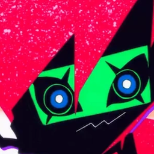

# Phishing-Check mit Capri

**Browser-Erweiterung, die Phishing erkennt, bevor du darauf hereinfällst –<br>mit einer animierten 3D-Wächterin, die dich warnt, erklärt und auf Zuruf hilft.**


</div>

---

## Worum geht es?

Phishing ist der häufigste Einstieg für Angriffe auf Privatpersonen und Firmen. Die meisten Opfer erkennen
gefälschte Seiten nicht, weil die Warnsignale klein sind: ein `1` statt `l`, ein kyrillisches `а`, ein Formular,
das an eine fremde Adresse sendet.

**Phishing-Check** prüft jede Seite, jeden Link, jeden E-Mail-Absender und sogar QR-Codes direkt im Browser.
Statt einer trockenen Fehlermeldung meldet sich **Capri**: eine animierte Figur, die wütend wird, wenn sie etwas
findet, in einfachen Worten erklärt *warum* etwas gefährlich ist, und damit nebenbei Sicherheitsbewusstsein trainiert.

<div align="center">
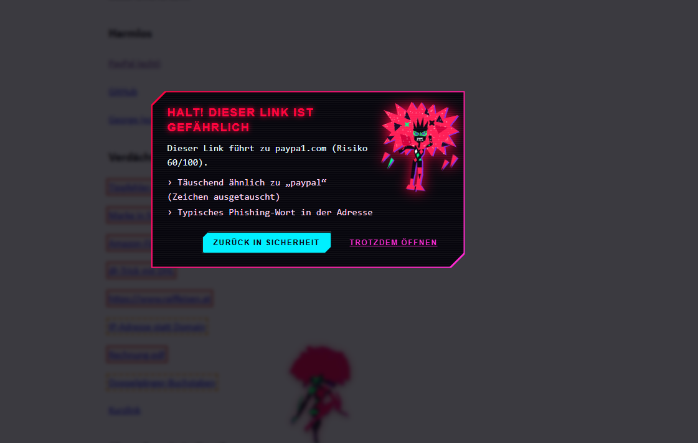
<br><sub>Klick auf <code>paypa1.com</code> wird abgefangen – mit Begründung und Risiko-Score.</sub>
</div>

---

## Highlights

| | Funktion | Was passiert |
|---|---|---|
| 🔗 | **Link-Analyse** | Jeder Link der Seite bekommt einen Risiko-Score (0–100). Gefährliche werden rot markiert, Klicks darauf abgefangen. |
| 🧾 | **Sperrlisten** | ~150 000 bekannte Betrugs- und Malware-Domains (URLhaus, OpenPhish, Phishing Army, HaGeZi), alle 12 h aktualisiert. Gelistete Seiten werden schon *vor* dem Laden blockiert. |
| 🔤 | **Doppelgänger-Domains** | Eigener Punycode-Decoder (RFC 3492) und Homoglyph-Erkennung: `xn--80ak6aa92e.com` wird als `аррӏе.com` entlarvt. |
| 🔑 | **Formular-Wächter** | Warnt beim Klick in ein Passwort- oder Kreditkartenfeld, wenn die Seite verdächtig ist, kein HTTPS nutzt oder das Formular an eine fremde Domain sendet. |
| 🧠 | **Passwort-Wiederverwendung** | Erkennt, wenn das Bank-Passwort auf einer fremden Domain eingetippt wird – ohne das Passwort je zu speichern (nur PBKDF2-Hash). |
| ✉️ | **Gmail & Outlook Web** | Vergleicht Anzeigename mit echter Absenderadresse („PayPal“ ‹x@random.xyz›) und erkennt getarnte Anhänge wie `Rechnung.pdf.exe`. |
| ▦ | **QR-Codes (Quishing)** | Liest QR-Codes in Bildern und prüft die versteckte Zieladresse. |
| 📅 | **Domain-Alter** | Fragt per RDAP ab, wann eine Domain registriert wurde. Unter 30 Tage alt = starkes Warnsignal. |
| 🚦 | **Link-Vorschau** | Beim Überfahren zeigt Capri das *echte* Ziel jedes Links mit Ampel. |
| 🛡️ | **Lernt mit** | Was die vorhandene Sicherheitssoftware (z. B. Symantec) blockiert, merkt sich die Erweiterung und blockt es künftig selbst. |
| 🎙️ | **Sprachsteuerung** | `Alt+Shift+C`: „prüf diesen Link“, „ist die Seite sicher?“, „lies mir die Seite vor“, „erinnere mich in 10 Minuten“ … |

---

## Capri – die Wächterin

Capri ist nicht nur Deko: Eine Figur, die sich ärgert, wird wahrgenommen. Eine graue Infobox nicht.

<table align="center">
<tr>
<td align="center">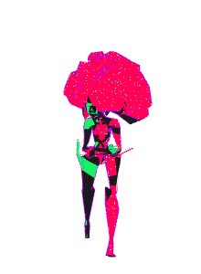<br><b>Wache</b><br><sub>auf Bankseiten</sub></td>
<td align="center">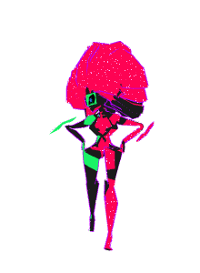<br><b>Stolz &amp; frech</b><br><sub>nach einem Fund</sub></td>
<td align="center">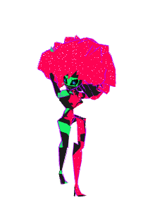<br><b>Tanzt</b><br><sub>bei YouTube-Videos</sub></td>
<td align="center">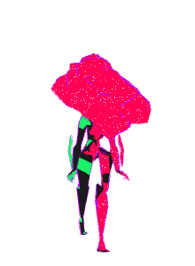<br><b>Schläft</b><br><sub>nach 1 Min. Ruhe</sub></td>
</tr>
</table>

- **Echtes 3D-Modell** mit Three.js, gerendert in einem isolierten iframe der Erweiterung.
- **Eigenes Skelett zur Laufzeit:** Das Modell hat keine Knochen. `capri-rig3d.js` erzeugt beim Laden ein Skelett
  und verteilt die Vertex-Gewichte über Wege entlang der Oberfläche, damit sich berührende Glieder nicht verkleben.
- **Prozedurale Animation:** Laufen, Rennen, Springen, Winken, Stampfen, Tanzen – jede Pose wird pro Frame berechnet und weich überblendet.
- **Shader-Effekte:** wehende, glitzernde Haare, rotes Glühen bei Ärger, Neon-Puls auf dunklen Seiten.
- **Stimmungen:** wird wütend bei Funden, danach stolz und aufgedreht, schläft ein, wenn nichts passiert.
- **Fallback:** Ohne WebGL übernimmt eine handgezeichnete, ebenfalls animierte SVG-Version.
- **Barrierefrei:** Bei „Bewegung reduzieren“ steht sie still.

---

## Screenshots

<table>
<tr>
<td width="50%">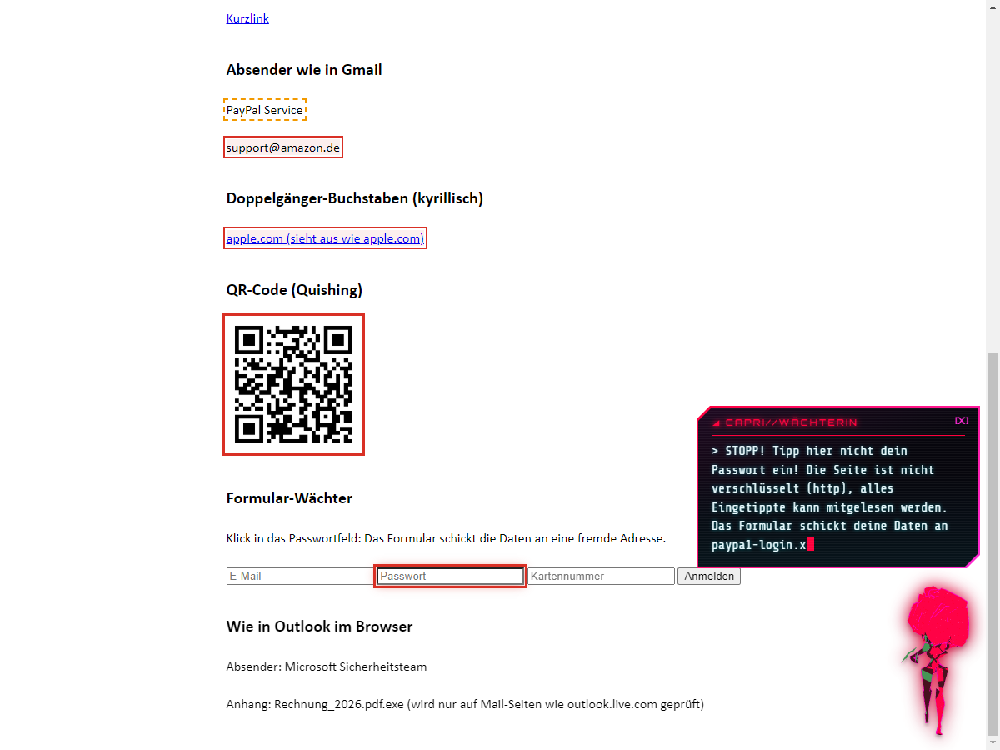<br><sub><b>Formular-Wächter:</b> Passwortfeld auf HTTP, Formular sendet an fremde Domain. QR-Code darüber bereits als gefährlich erkannt.</sub></td>
<td width="50%">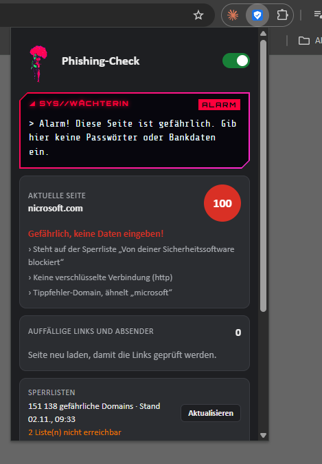<br><sub><b>Popup:</b> Score der aktuellen Seite mit allen Gründen, Sperrlisten-Status.</sub></td>
</tr>
<tr>
<td>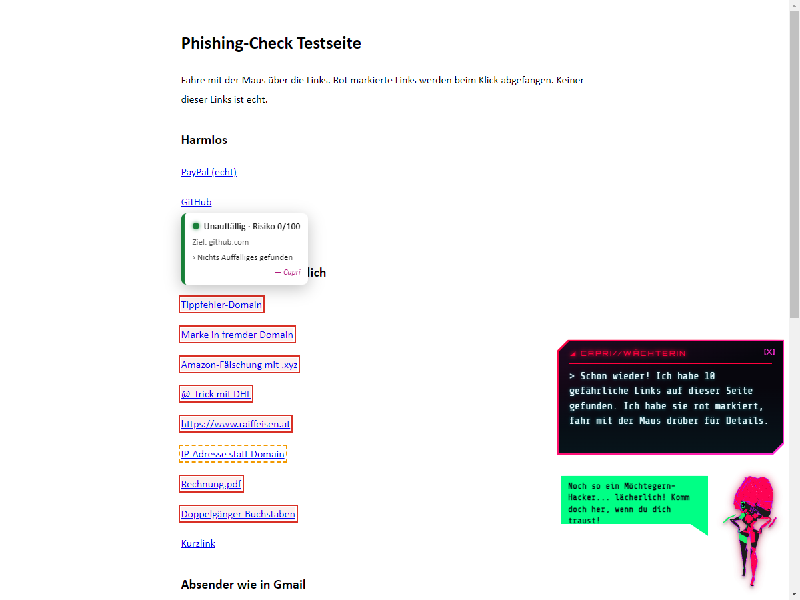<br><sub><b>Link-Vorschau:</b> echtes Ziel und Ampel beim Überfahren.</sub></td>
<td>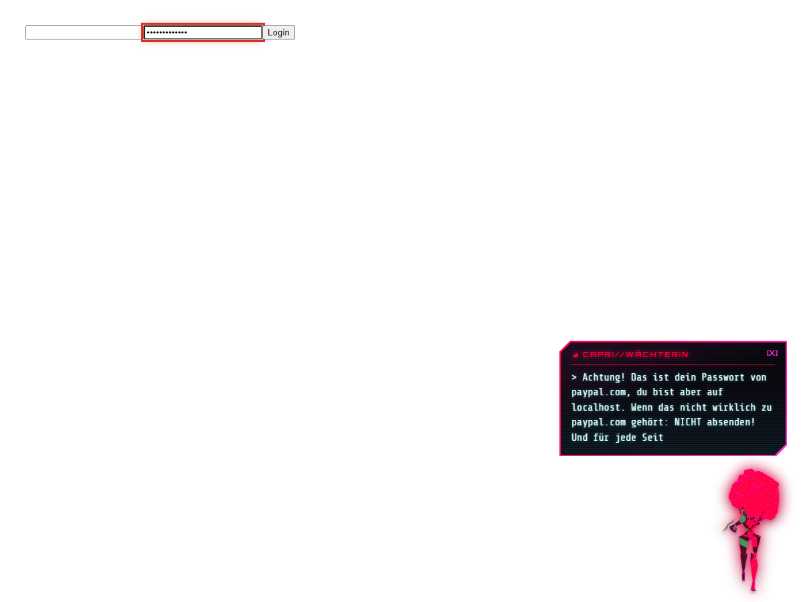<br><sub><b>Passwort-Alarm:</b> PayPal-Passwort auf fremder Domain eingetippt.</sub></td>
</tr>
</table>

<details>
<summary><b>Einstellungsseite anzeigen</b></summary>
<br>
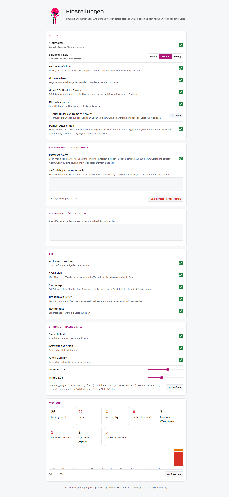
</details>

---

## Wie es funktioniert

### Architektur

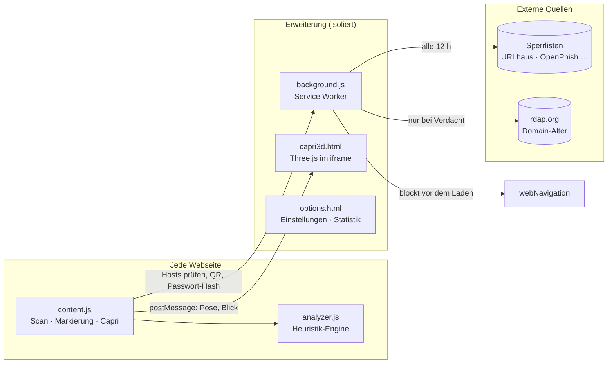

| Datei | Aufgabe |
|---|---|
| [`analyzer.js`](phishing-check/analyzer.js) | Heuristik-Engine ohne Abhängigkeiten: URL-, Absender- und Dateinamen-Analyse, Punycode, Homoglyphen, Levenshtein. Läuft im Browser und in Node. |
| [`content.js`](phishing-check/content.js) | Scannt die Seite (inkl. dynamisch nachgeladener Inhalte per `MutationObserver`), markiert Funde, Formular-Wächter, Link-Vorschau, Capri-Animation und Sprachbefehle. |
| [`background.js`](phishing-check/background.js) | Sperrlisten laden und durchsuchen, Navigation blockieren, RDAP-Abfragen, Passwort-Hashes, QR-Decoding, Statistik, Sprachausgabe, Erinnerungen. |
| [`capri3d.js`](phishing-check/capri3d.js) · [`capri-rig3d.js`](phishing-check/capri-rig3d.js) | 3D-Rendering, Laufzeit-Skelett, Posen und Shader. |
| [`options.html`](phishing-check/options.html) | Alle Funktionen einzeln schaltbar, Empfindlichkeit, Whitelist, Statistik mit 14-Tage-Verlauf. |
| [`build-firefox.ps1`](build-firefox.ps1) | Baut aus demselben Code eine Firefox-Version. |

### Erkennung: Punkte statt Ja/Nein

Jedes Merkmal gibt Risikopunkte. Die Summe (max. 100) entscheidet über die Stufe – die Grenzen sind in den Einstellungen wählbar (Locker / Normal / Streng).

| Merkmal | Beispiel | Punkte |
|---|---|---:|
| Steht auf einer Sperrliste | – | 100 |
| Doppelgänger-Domain mit fremden Schriftzeichen | `аррӏе.com` | 70 |
| Getarnte Programmdatei | `rechnung.pdf.exe` | 60–70 |
| Linktext zeigt andere Domain als das Ziel | Text `raiffeisen.at`, Ziel `evil.net` | 60 |
| Zeichen ausgetauscht | `paypa1.com`, `amaz0n` | 55 |
| `@`-Trick in der Adresse | `dhl.de@evil.top` | 50 |
| Tippfehler-Domain (Levenshtein 1–2) | `paypall.com` | 50 |
| Domain jünger als 30 Tage | via RDAP | 40 |
| Markenname in fremder Domain | `paypal-secure-login.com` | 40 |
| IP-Adresse statt Name | `http://192.168.4.20/bank` | 35 |
| Mehrere Phishing-Wörter | `login`, `konto`, `bestaetigen` | 20 |
| Verdächtige Endung / Kurzlink | `.xyz`, `bit.ly` | 15 |
| Kein HTTPS | `http://` | 10 |

**Normal:** ab 30 Punkten *verdächtig* (gelb), ab 60 *gefährlich* (rot, Klick wird abgefangen).

### Datenschutz by Design

- **Keine eigenen Server, kein Tracking.** Alle Prüfungen laufen lokal im Browser.
- **Passwörter werden nie gespeichert.** Nur ein PBKDF2-Hash (SHA-256, 150 000 Runden, zufälliges Salz pro Installation),
  nur für Bank- und Markenseiten, nur auf dem eigenen Gerät. Der Hash verlässt den Browser nicht.
- **RDAP sparsam:** Domains gehen nur bei bereits verdächtigen Seiten, Login-Formularen oder auf ausdrückliche Frage an rdap.org.
- **Minimal-Berechtigungen:** Zugriff auf fremde Bilder (für QR-Codes) ist optional und muss in den Einstellungen erteilt werden.
- **Sprachsteuerung nur auf Tastendruck,** nie dauerhaftes Mithören.
- **Sicher gegen Seiten-Skripte:** Capri, Sprache und 3D laufen in isolierten Erweiterungs-Kontexten. Sprachbefehle öffnen nur
  selbst gebaute URLs (`encodeURIComponent`), nie Text aus dem Gesprochenen.

---

## Installation

**Chrome / Edge**

1. Repository klonen oder als ZIP herunterladen.
2. `chrome://extensions` öffnen, **Entwicklermodus** einschalten.
3. **Entpackte Erweiterung laden** → Ordner `phishing-check` wählen.
4. `phishing-check/test-seite.html` öffnen (dafür in den Details der Erweiterung *Zugriff auf Datei-URLs* erlauben) – Capri findet sofort mehrere Fallen.

**Firefox 121+**

```powershell
powershell -ExecutionPolicy Bypass -File .\build-firefox.ps1
```

Dann `about:debugging#/runtime/this-firefox` → **Temporäres Add-on laden** → `dist/firefox/manifest.json`.

---

## Getestet

Automatisierter End-to-End-Test mit **Playwright** in Chromium mit geladener Erweiterung:

- ✅ Gefährliche Links, Tippfehler- und Doppelgänger-Domains werden markiert
- ✅ QR-Code mit Phishing-Ziel wird gelesen und rot markiert
- ✅ Link-Vorschau mit grüner Ampel für harmlose Links
- ✅ Formular-Wächter warnt bei HTTP und fremdem Formularziel
- ✅ Gefälschter Absender und `.pdf.exe`-Anhang auf einer Webmail-Seite erkannt
- ✅ Passwort-Hash wird gespeichert (kein Klartext), Wiederverwendung auf fremder Domain löst Alarm aus
- ✅ Nachtmodus, Statistik und Einstellungen funktionieren

---

## Tech-Stack

**Vanilla JavaScript** (kein Framework, kein Build-Schritt) · **Chrome Extensions Manifest V3** (Service Worker, `webNavigation`, `storage`, `alarms`, `tts`, `commands`) ·
**Three.js** + **GLSL-Shader** · **Web Crypto API** (PBKDF2) · **Web Speech API** · **Web Audio API** (Glitch-Sound) · **OffscreenCanvas** + **jsQR** ·
**RDAP** · **Playwright** (Tests) · **PowerShell** (Firefox-Build)

---

## Credits & Lizenzen

- 3D-Modell: [„Capri (Project Capricorn)“](https://sketchfab.com/0x00001337) by 0x00001337, [CC BY 4.0](https://creativecommons.org/licenses/by/4.0/)
- [Three.js](https://threejs.org) r147 – MIT
- [jsQR](https://github.com/cozmo/jsQR) 1.4.0 – Apache 2.0
- Sperrlisten: [URLhaus](https://urlhaus.abuse.ch), [OpenPhish](https://openphish.com), [Phishing Army](https://phishing.army), [HaGeZi](https://github.com/hagezi/dns-blocklists)
- Die Figur Capri stammt aus *Cyberpunk: Edgerunners 2* (CD PROJEKT RED / Studio Trigger). Dies ist ein privates,
  nicht-kommerzielles Fan- und Schulprojekt und wird nicht im Chrome Web Store veröffentlicht.

Entwicklungsnotizen und verwendete Werkzeuge: [docs/ENTWICKLUNG.md](docs/ENTWICKLUNG.md)

<div align="center">
<br>
<sub>Entwickelt von <a href="https://github.com/Tscheky0">Tscheky0</a> · Schulungszentrum-Projekt 2026</sub>
</div>
